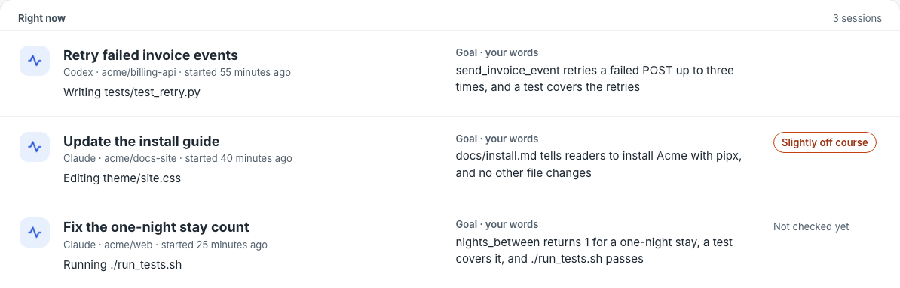

# What is Spacedock Compass

When several agents are working, Spacedock Compass shows which sessions need you and where the work has moved away from the goal you set.

## How it works

Compass reads the session records your agents already write and shows them on a local board. Sessions opens with counts for **Waiting on you**, **Working now** and **Worth a look**. Each row pairs the session's state and current work with its goal. The light board uses plain words, with exact times, identifiers and byte sizes under **Show technical details**.

*In **Right now**, the **Slightly off course** pill comes from a saved progress check whose evidence still matches.*

A session's page puts **Goal** and **Is it on track?** ahead of the evidence. When you [check progress](use.md#check-a-sessions-progress), Compass compares the goal with the session's recorded work and cites the entries behind any finding. The level describes what the check could support from that record. You decide whether to send the agent a correction or change the goal.

Compass reads session files without changing them and keeps its own records on your machine. Model features, including progress checks and summaries, can send session content through your signed-in Claude Code or Codex. **Pause all AI use** stops those calls. Quota reads, release lookups, pull request status reads and optional webhook nudges have their own controls. See [what can leave your machine](https://github.com/spacedock-dev/compass/blob/main/docs/how-it-works.md#what-can-leave-your-machine).

## With Workflow

If you run work through [Spacedock Workflow](../workflow/index.md), Compass also shows where each work item is and the decisions Workflow recorded for it. Compass can [alert you once](use.md#get-alerted-when-work-reaches-a-step) when an item reaches a step you pick.

## When to use it

- You run several agent sessions and want to see which ones need input.
- You step away during a long run and want to see what happened while you were gone.
- You want to review whether an agent followed your goal while there is still time to steer it.

**Related guides**

- [Set a goal and check a session's progress](use.md#set-the-goal).
- [Look up Compass commands, options and keys](reference.md).
