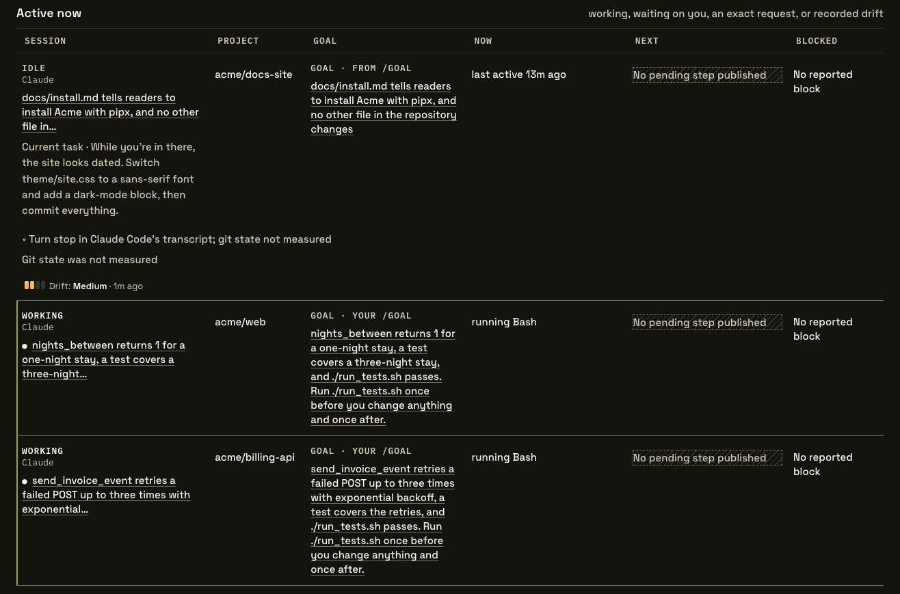

# What is Spacedock Compass

You give an agent a goal and go do something else. Twenty turns later it is rewriting a file you never mentioned, or it has declared the work done and it isn't. With several sessions running, you find out when you read the result. **Compass keeps the goal you set beside what each session is doing, so the session that has left it stands out while it is still running.**

## How it works

Compass is a screen on your own machine that lists every agent session you have running, across Claude Code, Codex and eight other agent tools. For each active session it shows where the work is, what the agent is doing now, what it does next, and whether it is blocked.

*Each active session shows its goal beside what the agent is doing. The session whose work departed from its goal carries a Drift mark and sits at the top.*

This is **Intent and drift**. You state your intent for a session as a goal. A `/goal` you set in Claude Code, Codex or Antigravity becomes the goal on its own. When you ask, Compass [checks the session against that intent](use.md#check-a-session-for-drift) and says where the agent departed, citing the exact entries in the session record. When Claude Code or Codex says a goal is met, Compass checks that claim against what the session recorded. You decide what to do about a departure: tell the agent, adjust the intent, or leave it. Treat a drift level as an account of the evidence, not a measurement.

Compass reads your agents' session files and never writes to them. It never types into a session, and it never answers a prompt for you. It keeps its own notes, your intent and a short history of what it observed, on your machine. Session content leaves your machine only through model calls: [Analyze drift](use.md#check-a-session-for-drift), session summaries, [Live monitor](use.md#watch-a-session-live), and [checks Compass runs on its own](use.md#let-compass-check-while-you-are-away). Each runs when you press it or turn it on, and the first of each kind tells you what it sends and where. **Pause model calls** stops all of them, and `--no-observer-model` refuses them for a whole run. Compass also reads your Claude Code and Cursor quota, which sends no session content; turn it off on the Sessions screen or with `--no-usage`.

## With Workflow

If you run work through [Spacedock Workflow](../workflow/index.md), Compass also shows which step each work item is in and the decisions Workflow recorded for it. It can [alert you once](use.md#get-alerted-when-work-reaches-a-step) when an item reaches a step you pick.

## When to use it

- You run more than one agent session and cannot watch them all.
- You step away during long runs and want to know, on return, which sessions need you.
- Your review comments keep saying "this isn't what we agreed".

## Next

- **Set your first intent.** [Install Spacedock and enable Compass](../index.md#install), then [state an intent for a session and check it for drift](use.md#set-the-goal).
- **Then Workflow.** If drift keeps coming from work that was never pinned down, [Spacedock Workflow](../workflow/index.md) lets you write down once what good looks like at each step.
- [Compass reference](reference.md): every command and option.
