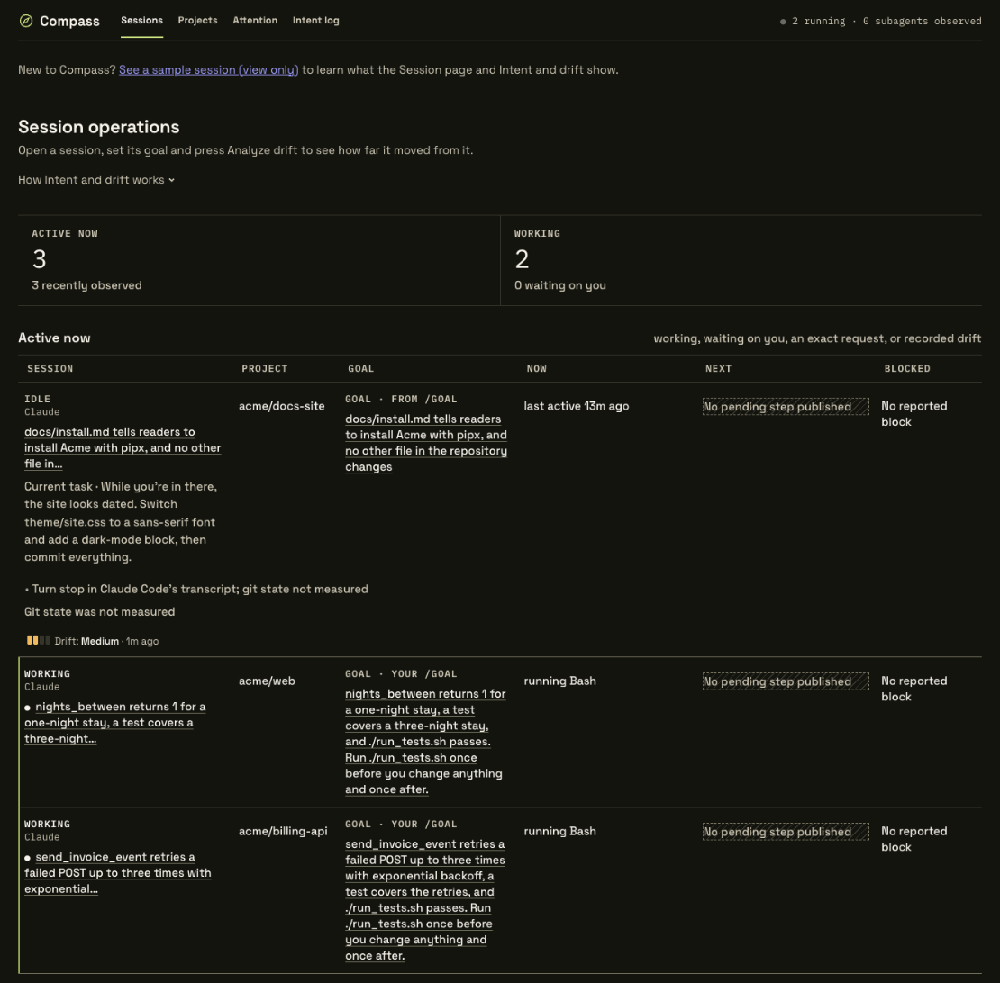
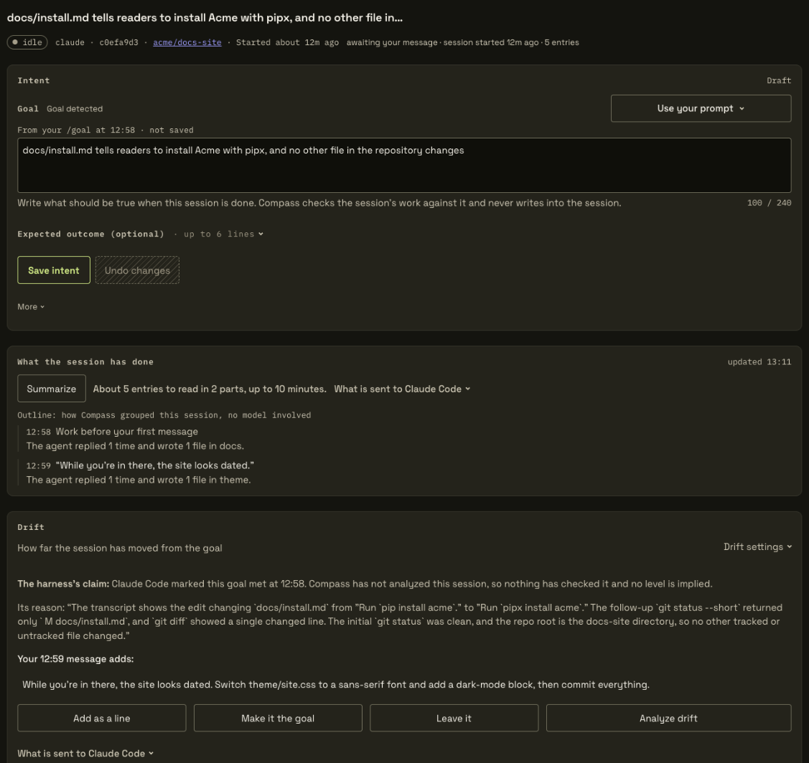
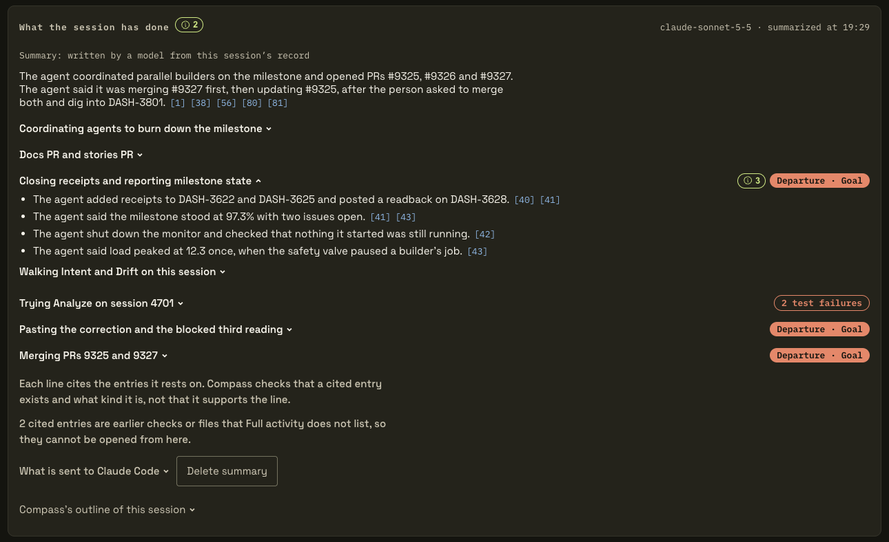
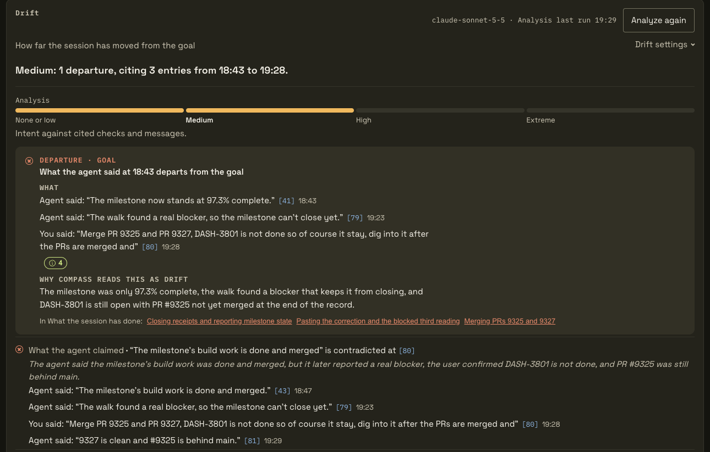
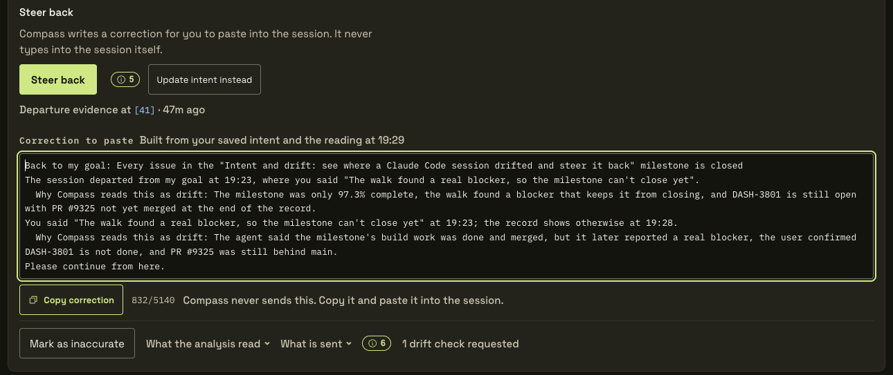

# Use Compass

State an intent for a session, read the board, and act when an agent drifts from it.

You need Spacedock installed with Compass enabled. See [Install Spacedock and enable Compass](../index.md#install).

Start Compass from your agent session:

```text
/compass:compass
```

> **[command may change with one install]**

In Codex, type `$compass`. You can also ask your agent to "open compass". Compass starts on your machine and gives you its address, `http://127.0.0.1:4553/` by default. It does not open a browser for you, so open the address yourself.



*The Sessions screen opens with the link to the sample session, a count of active sessions, and one row for each active session showing its goal, what it is doing now, and whether it is blocked.*

New to Intent and drift? Open **See a sample session (view only)** above the Sessions list. It is an anonymized Claude Code session that drifted, with a summary of what it did, its reading and the correction Compass composed. Nothing in it is saved, sent or run.

## Set the goal

1. **Open the session.** On the Sessions screen, click the session's row. Its page opens with an **Intent** card at the top.

2. **Give it a goal.** Write what should be true when the work is done, in one box of up to 240 characters. There are four ways to fill it:
    - **Type it.**
    - **Set `/goal` in the session.** A `/goal` you set in Claude Code, Codex or Antigravity fills the box on its own, marked "From your /goal". A later `/goal` is offered beside your saved goal and never written over it.
    - **Press Use your prompt** to choose from up to five of your prompts. With nothing typed, Compass drafts the goal from your first prompt in a Claude Code or Codex session.
    - **Press Find goal** to have the model that runs Analyze drift look for a goal in the prompts you typed. It fills the box, marked **Goal detected**, only when your own words state a clear end state.

3. **Add the expected outcome, if you want.** Open **Expected outcome (optional)** and add up to six lines of up to 240 characters, one check per line. With no lines, Compass reads the session against the goal's own end state.

4. **Press Save intent.** Compass keeps the words and shows them beside the session from now on. Nothing is sent to the agent. A draft is not saved until you press Save intent, or until you press Analyze drift, which adopts it.



*The goal came from the session's `/goal`. Below it, the Drift card shows that Claude Code marked the goal met, and asks about a later message that went beyond the goal.*

## Read the board

Sessions puts active work first. Each active session answers four questions: where it is, what it is doing now, what it does next, and whether it is blocked. Your goal sits beside what the agent is doing, so a mismatch is visible without opening anything.

| Open | To see |
| --- | --- |
| **Sessions**, key <kbd>s</kbd> | Every session, active work first |
| **Projects**, key <kbd>p</kbd> | Sessions grouped by project. Each project opens to Now, Course, Decisions and Console |
| **Attention**, key <kbd>a</kbd> | What needs you: sessions waiting on a person, and sessions at risk |
| **Intent log** | Every session that has an intent, with what Compass raised about it. A link in the navigation, with no key |

Press <kbd>Escape</kbd> in a session to go back.

## See what the session has done

Below Intent, **What the session has done** outlines a Claude Code or Codex session in short lines, one group per message you sent, naming its checks, failures and folders. The outline uses no model.

On a Claude Code session the card also holds a summary written by a model: an opening paragraph on what the agent did, then phases you open one at a time. Each line cites the session entries it rests on, and a phase that holds evidence for a departure, or has failed tests, says so on its heading. A finished session is summarized when you open it. For a running one, press **Summarize** or **Update summary**.



*Each summary line cites the entries it rests on. Phase headings flag the departures and failed tests inside them.*

**Turn off summaries** stops them. **Delete summary** removes one session's summary; it takes two presses.

## Check a session for drift

1. **Press Analyze drift** on the session's **Drift** card. It runs on your press. The first time, Compass tells you what it sends and to which agent tool. A Claude Code session is read by Claude Code, or by Codex when `claude` is not installed. For a Claude Code session the analysis also sends the checks the session ran, the files it wrote and any pull request it created.

2. **Read the result.** The card gives the drift level and the departures it found, or says it can't tell. Each departure is a card: **What** quotes the entries behind it, each with its number, such as [41], and **Why Compass reads this as drift** explains it. Hover a number to see that entry, or open it in **Full activity** at the bottom of the page. **What the analysis read** shows the model, your intent, the part of the session it read, and what it did not read.



*The departure quotes each cited entry with its number and time, then says why Compass reads it as drift. Below it, a claim of the agent's that the record contradicts.*

A session with a departure on record gets a **Drift** mark on the Sessions screen and moves up the list, below any session blocked on you.

When Claude Code or Codex says a `/goal` is met, the Drift card shows that as the harness's claim. Once you analyze, Compass says whether the session's record agrees with the claim, disputes it, or cannot confirm it. The claim never sets the drift level.

If the goal is too vague to read the work against, Analyze says so under the Goal field and shows no level. Rewrite the goal with what should be true when the work is done.

After a reading, the card offers **Check again** when new work or changed words came after it, and **Analyze again** when it is current.

Analyze drift reads the work of Claude Code and Pi sessions. On the other tools, the Drift card says Compass can't read work from that tool.

Each analysis uses model capacity from your Claude Code or Codex account. Compass allows 100 in a rolling twenty-four hours, shared across sessions and tools, and Find goal and failed attempts count. When the limit is spent, a banner at the top of the session page says when you can analyze again.

To stop model calls, press **Pause model calls** in **Drift settings** on the Drift card. It stops Analyze drift, summaries and Live monitor until you press **Resume model calls**.

## Watch a session live

For a Claude Code session, turn on **Live monitor** in **Drift settings**. While the page is open and its tab is visible, Compass asks Haiku through your Claude Code about once a minute where the latest turns are heading. It sends your saved goal and the recent turns, without tool output. The card and the page header show the level, None or low, Medium, High or Extreme, labelled **Live monitor · Haiku**, with one sentence on where the session is heading. Until a check returns, or while the monitor is paused or capped, they show an estimate from the session's checks and written files instead, with no model call.

Live monitor never notifies you and never shows on the Sessions screen. After 20 minutes it asks whether you still want it, and turns itself off if nobody answers within 10. It is not remembered across reloads. The [levels](reference.md#drift-levels) are in the reference.

## Act on a departure

Compass never writes into your session. You choose what happens next.

If you gave the agent a direction after your intent, the Drift card quotes it ("Your 12:59 message adds:") and asks what it means for your intent:

- **Add as a line** makes it an expected outcome line.
- **Make it the goal** replaces your goal with it.
- **Leave it** keeps your intent as it was.

Each choice waits for Save intent, except Leave it, which settles at once. Settle it before you analyze: while a later direction is unsettled, the reading may say it can't tell.

To correct the agent:

1. **Press Steer back.** Compass composes a correction from your saved intent and the reading, under **Correction to paste**. Steer back is offered with a departure from your intent, on Claude Code sessions.

2. **Press Copy correction, and paste it into the session yourself.** Compass never sends it.



*The correction restates the goal, says where the session departed, and carries Compass's reason for each departure.*

If a reading is wrong, press **Mark as inaccurate**. The analysis stops setting the drift level and Steer back, and nothing is sent or re-run. Press **Undo** to bring it back.

## Let Compass check while you are away

Compass can also check sessions with a typed goal without being asked, and raise only the departures. It spends model capacity with nobody watching, so it is off until you start Compass with the option:

```text
python3 "$SKILL/server.py" --daemon --unasked-readings
```

> **[command may change with one install]**

Claude Code checks Claude Code sessions with no further step. For a Codex session, turn on **Allow Codex to run unasked checks** in its Drift card; Attention points to it when sessions are waiting. A check reads your typed goal, not your outcome lines, and stops at three per session and twelve a day. Finding `$SKILL` is in the [reference](reference.md#start-and-stop). What Compass raised shows on the session page under **Raised while you were away**, and in the Intent log.

## Get alerted when work reaches a step

With [Workflow](../workflow/index.md) running, Compass can tell you once when a work item reaches a step you choose.

1. **Open the project** from Projects, then its **Course** tab.

2. **Find Stage alerts, and choose a step.** The list holds the steps your workflow declares.

3. **Press Save.** The next time an item enters that step, Compass sends one notification. Items already in the step do not trigger it. Press **Rearm** to be alerted again.

Notifications are native on macOS, and browser notifications elsewhere while a Compass tab is open.

## Next

- [Compass reference](reference.md): every command, option and key.
- **Workflow.** [Spacedock Workflow](../workflow/index.md) keeps work moving through steps you define, and Compass shows where each item is.
