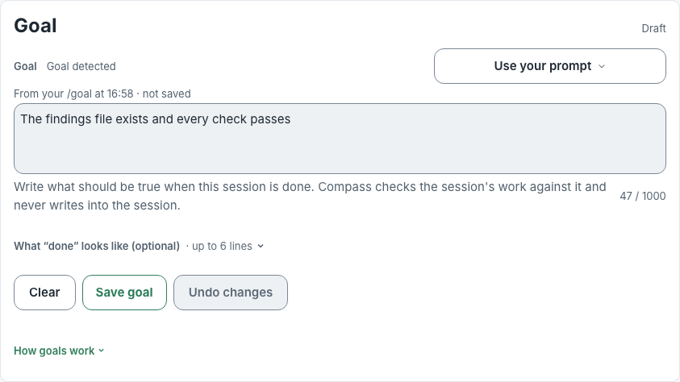
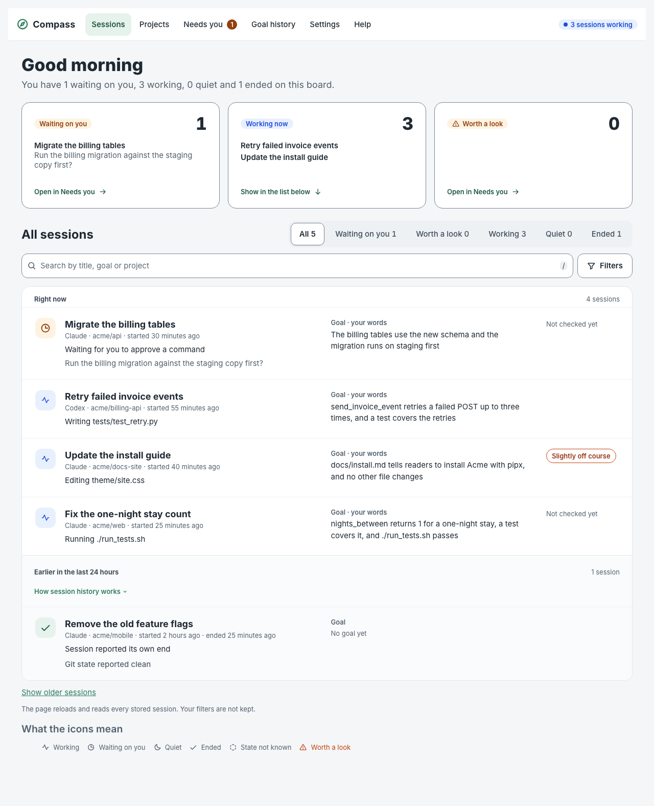
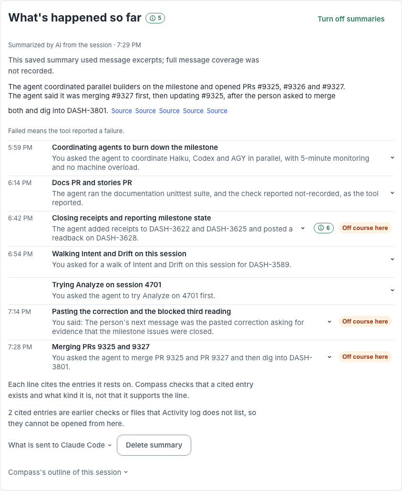
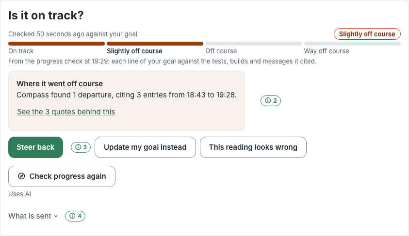
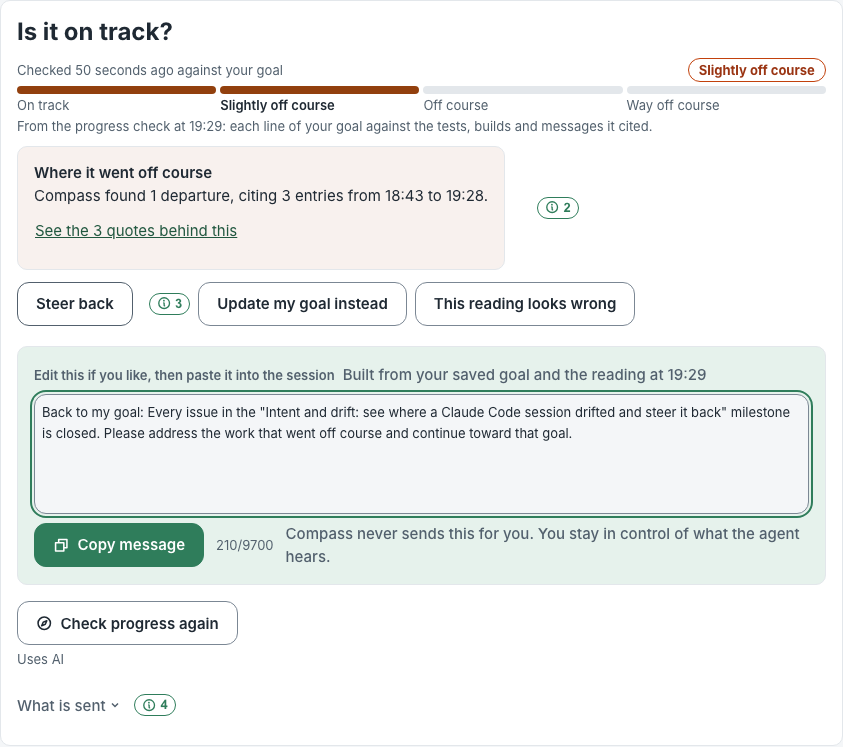

# Use Compass

Use Spacedock Compass to find sessions that need you, check their progress and steer work back toward your goal.

[Install Spacedock](../get-started/install.md#install-spacedock), which includes Compass by default. For the Claude Code and Codex commands below, [set up your agent](../get-started/install.md#set-up-your-agent). You can also [install Compass on its own](https://github.com/spacedock-dev/compass#1-how-to-set-up).

## Start Compass

1. Run the command for where you want to start it.

    === "Claude Code"

        ```text
        /spacedock:compass
        ```

    === "Codex"

        ```text
        $spacedock:compass
        ```

    === "Terminal"

        ```bash
        spacedock compass --daemon
        ```

2. Open `http://127.0.0.1:4553/` in your browser. **Sessions** opens first.

For a walkthrough with saved results, choose **See an example** above the Sessions list or in **Help**. The example is a view-only Claude Code session with a goal, a summary and a completed progress check.

## Set the goal

1. **Open a session.** Select its row in **Sessions**. Its page starts with **Goal** and **Is it on track?**
2. **Fill in the goal.** Use **Edit goal** to type what should be true when the work is done. A `/goal` from Claude Code, Codex or Antigravity can fill the goal for you. **Use your prompt** lets you choose one of your messages. When you have no saved or detected goal, **Find goal** asks a model to look for a clear end state in your messages.
3. **Add a line if you want a specific result checked.** Use **What “done” looks like (optional)** for up to six lines. With no lines, Compass checks against the end state in the goal.
4. **Press Save goal.** The goal appears on the session page and its Sessions row. **Check progress** can also save and use an untouched draft.



*The line above the goal says it came from your `/goal` and is not saved yet. Press **Save goal** to keep it.*

## Read the board

1. **Open Sessions.** Find current work under **Right now**. Use the status tabs to narrow the list to sessions such as **Waiting on you** or **Working**.
2. **Search for a session.** Use the search field for a title, goal, prompt or project name. Open **Filters** to narrow the results by **Project**, **Agent**, **Started** or **Progress check**.



*The three cards at the top count what needs you. **Waiting on you** and **Worth a look** open **Needs you**, and **Working now** shows those sessions in the list below.*

| Open | To see |
| --- | --- |
| **Needs you** | **Waiting on you** first, followed by **Worth a look** and **Ready to wrap up**. |
| **Projects** | Sessions grouped by project. Open a project to see its **Overview**, **Timeline**, **Decisions** and **Usage and alerts**. |
| **Goal history** | Current and older goals, searchable by goal text or session title. |
| **Settings** | AI use, notifications and progress check limits. Changes save as you make them. |
| **Help** | The icon legend, progress check terms and **See an example**. |

At the top of Sessions, **Your AI allowance** shows the usage and reset time Compass has for your plan. Claude's five-hour and weekly figures can come from your [Claude Code status line](https://github.com/spacedock-dev/compass/blob/main/HOW_TO_USE.md#show-claudes-allowance-on-the-board-from-your-status-line) without a login token.

On a session page, open **Show technical details** for exact values and the **Activity log**. Filter its entries by **You**, **Agent**, **Commands**, **Files** or **Cited**.

## See what's happened so far

1. **Read What's happened so far.** The outline groups the record by your messages. The Claude Code outline also includes the agent's replies and recorded work.
2. **Open a phase of the summary.** On Claude Code sessions, each phase links to the entries it rests on. If there is no summary for a running session, press **Summarize**. Opening an ended session can start a missing summary when summaries are enabled.



*In **What's happened so far**, **Off course here** opens the evidence for that phase.*

Use **Turn off summaries** to stop session summaries. **Delete summary** removes the saved summary for the session and asks you to confirm on a second press.

## Check a session's progress

Before you check, **What is sent** explains what goes to the model and where. Find it under **Show technical details** on the **AI use and privacy** tab.

1. **Press Check progress** in the session header or in **Is it on track?** Both controls wait for the same result.
2. **Read Is it on track?** It shows what the check found and a [progress level](reference.md#progress-levels) when the evidence supports one. Follow the quotes link to **Evidence**, then open a citation to jump to its entry in the **Activity log**.



*The quotes behind **Slightly off course** show where the work departed from the goal.*

When Claude Code or Codex reports a goal as complete, **Is it on track?** shows the agent's claim. A progress check can compare it with the record. If you see **Goal too vague to check**, edit the goal to say what should be true when the work is done. Use **Check progress again** to run another check.

To stop Compass's model calls across sessions, open **Settings** and press **Pause all AI use**. **Resume AI use** makes them available again.

## Watch a session live

1. **Open Show technical details** on a Claude Code session. Select **AI use and privacy**.
2. **Turn on Live monitor.** While you view the page, Compass uses Haiku through Claude Code to check new work about once a minute. The source appears as **Live monitor · Haiku**. While waiting for a monitor result, Compass can show a **Live estimate** from recorded checks and file paths.

The browser asks after 20 minutes whether you still want to watch. It stops monitoring if you leave the session or let that question go unanswered for 10 minutes.

## Act on a departure

If **Is it on track?** asks whether a later message changes your goal, choose **Add as a line**, **Make it the goal** or **Leave it**. Use **Save goal** to keep a change. **Leave it** settles the question on its own.

1. **Press Steer back** when a check offers it. Compass opens an editable message based on the goal and the finding.
2. **Press Copy message.** The message goes to your clipboard.
3. **Paste the message into the session** when you want the agent to act on it.



*Review the message under **Steer back** before you copy it into the session.*

If the check looks wrong, press **This reading looks wrong**. Compass sets aside its level and **Steer back**. Press **Undo** to restore them if the evidence still supports them.

## Let Compass check while you are away

1. **Start Compass with unasked checks enabled.** This lets Compass spend model capacity on eligible sessions while you are away.

    ```bash
    spacedock compass --daemon --unasked-readings
    ```

2. **Type or edit a goal, then use Save goal.** Unasked checks use goals you wrote. A goal adopted unchanged from `/goal` or a prompt is ineligible.
3. **Turn on Allow Codex to run unasked checks** in **Is it on track?** if Codex will run the check. **Needs you** points to this control when permission is needed.
4. **Look for Raised while you were away** on the session page to read any departures Compass found.

## Get alerted when work reaches a step

1. **Open the project** in **Projects**. Its **Overview** shows current work.
2. **Open Show technical details** to find **Stage alerts**.
3. **Choose a stage** from your Workflow.
4. **Press Save.** A later observed entry into that stage triggers one alert. Press **Rearm** to be alerted again.

**Related guides**

- [See what Compass can tell you about your sessions](index.md).
- [Look up supported tools, options and keyboard shortcuts](reference.md).
