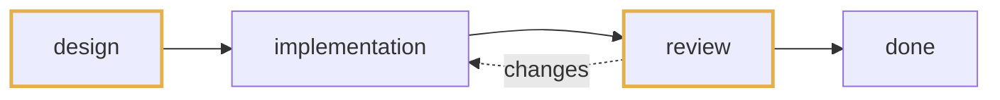

# The stage lifecycle

Each work item moves through the stages in your workflow. Each stage defines the work to do and the evidence required.

## A development workflow

In this example, the outlined stages pause for your decision: before implementation and after review.

Requested changes return to implementation. The reviewer checks the revised work before it returns to you.

## Stage settings

You can ask your agent to configure a stage to:

- Pause at a [gate](gates-and-decisions.md).
- Use a separate reviewer with fresh context.
- Return findings to the stage responsible for corrections.
- Limit concurrent work or use a specialist agent.

## Isolated work

Code stages can use separate Git worktrees so work items have their own branches and files.

**Related guides**

- [Workflow design](../running-workflows/commission.md)
- [Gates and decisions](gates-and-decisions.md)
