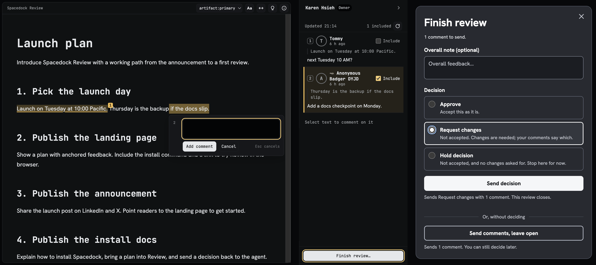

# Browser review

Review your agent’s work in your browser. Spacedock hosts the uploaded document; your agent stays in its existing environment.

## Open your review

Ask your agent to send a file through Spacedock Review and choose **Web**. After you agree to the upload, it opens your owner link. Press **Sign in as owner** so you can make the decision.

Keep the owner link for yourself. The separate share link is for [inviting others](sharing.md).

## Comment and decide

1. Select a passage and add a comment.
2. Press **Finish review**. Choose **Approve**, **Request changes** or **Hold decision**.
3. Press **Send decision**. Your agent receives the decision and included comments. The review closes.

Your unsent comments are included automatically. For comments already sent, select **Include** beside each one you want returned with your decision.

To send comments while keeping the review open, choose **Send comments, leave open**. You can decide later.

After **Request changes**, your agent revises the file and presents the changed version under a new link.

## Recovery

If your owner link has expired or was already used, ask your agent to publish again. If your agent stopped waiting, ask it to check your decision.

**Related guides**

- [Sharing](sharing.md)
- [Comments and decisions](decisions.md)
- [Link expiry and waiting limits](reference.md#limits)
