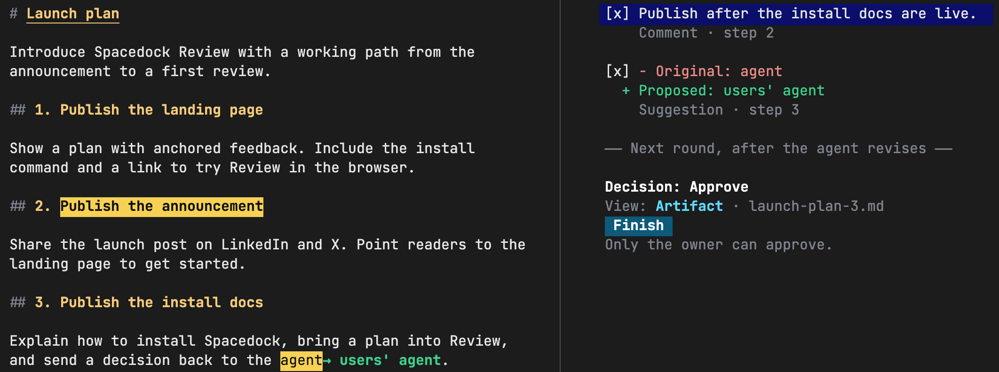

# Spacedock Review

Your agent brings you a plan, spec or draft. Review the work and decide what happens next.

## Your decision

Select text to leave a comment, then make the call:

- **Approve:** the agent can proceed.
- **Request changes:** ask the agent to revise.
- **Hold decision:** pause the work.

Your agent picks up your feedback and acts on your decision. No need to copy it back into the conversation.

## Local and hosted

=== "Terminal"

    Review beside your agent. The document stays on your machine. Your agent can ask for comments or a decision.

    

    Comments and a suggested edit, followed by approval in the next round.

    [Supported terminals and controls](terminal.md)

=== "Browser"

    [review.spacedock.md](https://review.spacedock.md) is Spacedock’s hosted review service, free with [limits](reference.md#limits). Create an account for higher limits.

    Pair with your agent to make decisions. People you invite can comment without an account or installation.

    

    Your agent asks permission before it uploads a copy of your document. Anyone with the share link can read it.

## How it works

Spacedock Review uses a harness-neutral feedback gateway. Each requesting agent listens for its own review result through its harness integration.

When you finish, the result contains your decision, anchored comments and the document version you reviewed. The integration delivers it to the requesting conversation. Harnesses handle waiting and delivery differently, but use the same result format.

**Related guides**

- [Your first review](use.md): send your own plan, leave feedback and read the agent’s response.
- [Comments and decisions](decisions.md): what each decision means.
- [Sharing](sharing.md): invite others before you make the call.
- [Spacedock Workflow](../concepts/gates-and-decisions.md): configure gate content so each review brings you the evidence and context you need to decide.
