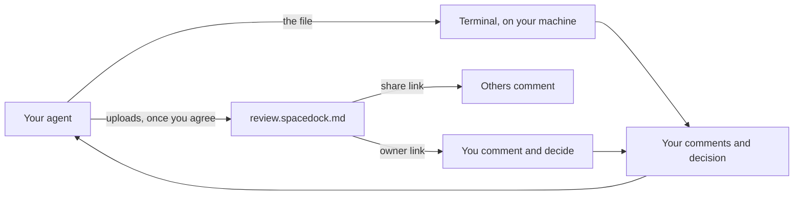

# What is Spacedock Review

Your agent hands you a plan, a spec or a draft as a Markdown file, and the next step waits on your call. Spacedock Review opens the file for you to read, comment on the exact lines and decide whether the work goes ahead. It sends your comments and decision back to the agent that asked.

## How it works

You review in one of two places, and you choose once per project.

- **Terminal.** The file opens beside your agent session and stays on your machine. You are the only reviewer.
- **Web.** The file is uploaded and you get two links. The owner link is yours: you open it, sign in and decide. The share link is for anyone else whose comments you want, people or their agents.

Your agent opens the file in the terminal or, once you agree, uploads it to review.spacedock.md. Either way, your comments go back to the same agent. On the web you also decide; in the terminal you decide when your agent asks for a decision.

## What happens to a document you share

- The file uploads to review.spacedock.md, a service Spacedock runs, which keeps the file, the comments and your decision. Nothing uploads until you agree: Spacedock Review asks first, and remembers your answer for that project.
- Anyone holding the share link can read the whole document and comment on it. The address cannot be guessed. Treat it like a password: send it only to people who should read it.
- The share link stops working seven days after you share, and nothing extends it. Sharing a changed file makes a new link. Sharing the same file again keeps its link and expiry, and gives you a new owner link. To end it sooner, ask your agent to [revoke the link](reference.md#commands-your-agent-runs-for-web-reviews).

What stays yours:

- Only you decide. Reviewers comment. Only the owner can choose Approve, Request changes or Hold decision, and that decision goes back to the agent that asked.
- You see everyone's comments; each reviewer sees only their own.
- Reviewers need no account. They use a random name, or sign in to use their account's name; names are not verified. To become the owner, sign in from the owner link your first share gives you.
- Spacedock Review does not keep your email address or any visitor's IP address.

## Next

- [Review your agent's next file](use.md), in the terminal or the browser.
- [Look up an argument, key, decision or limit](reference.md).
- When you review the same kind of work again and again, [Spacedock Workflow](../workflow/index.md) brings you only the calls that need you, and you can decide them in Review.
