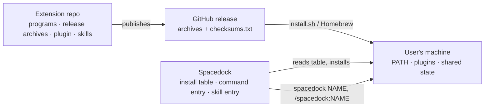

# Extension install contract

Status: v0 draft, awaiting agreement from each extension's maintainer
Date: 2026-10-12

## Outcome and ownership

A Spacedock extension is a separately developed and released product that one
Spacedock install brings along. Spacedock installs it from the extension's own
releases, finds it on PATH, and hands work to it. Nothing else about how an
extension is built or installed is Spacedock's concern. This file is the whole
seam: an extension that meets it installs and runs with `brew install spacedock`
or the `install.sh` line, and one that changes it breaks that path.



- **Spacedock owns** the install table, the two entry points, the companion
  plugin list, and where a recorded review choice lives.
- **Each extension owns** its programs, its release archives and checksums,
  its plugin and skills, and everything they do once started.

## Entry points

**Command.** `spacedock NAME ARGS…` runs the first `spacedock-NAME` on PATH with
`ARGS…` passed verbatim, and returns its exit code. Built-in commands always win.
A `NAME` that starts with `-` or contains `/` is never looked up. A match found
through a relative PATH entry is ignored. With no match, Spacedock prints
`unknown command: NAME` and exits 2. An extension provides `spacedock-NAME` as a
second name for its own program.

**Skill.** `/spacedock:NAME` is a skill in the Spacedock plugin. It stays thin:
it checks the extension is present, decides anything Spacedock owns, and hands off
to the extension's own skill or to `spacedock NAME`. It never reimplements extension behaviour.

## Release archives

An extension that Spacedock installs publishes, on its GitHub repository:

1. Stable releases, which Spacedock installs on both channels: the version its
   `spacedock` marketplace listing names. A prerelease may exist on GitHub, but
   Spacedock never installs one, and the release never writes it into the listing
   or into its Homebrew formula.
2. One archive per target, named `PREFIX_VERSION_OS_ARCH.tar.gz`, where `OS` is
   `darwin` or `linux` and `ARCH` is `arm64` or `amd64`. All four must exist,
   even when the payload is the same.
3. `VERSION` equal to the release tag without its leading `v`, prerelease
   suffix included. Tag `v0.29.0` publishes `PREFIX_0.29.0_darwin_arm64.tar.gz`;
   tag `v0.16.0-beta.2` publishes `PREFIX_0.16.0-beta.2_darwin_arm64.tar.gz`.
4. `checksums.txt` in the same release, one line per archive in the form
   `SHA256  FILENAME` (the output of `shasum -a 256`).
5. Programs at the archive root for kind `bin`. For kind `tree`, one top-level
   directory with the programs at the paths the table row lists, beside any files they
   run with.

Spacedock verifies each archive against `checksums.txt` before installing it.

Publish a release's tag and its archives together: when GitHub does not answer the
latest-release lookup, Spacedock installs the newest version tag it finds with
`git ls-remote`.

## Install table

`install.sh` holds one row per extension in `EXTRAS`:

```text
name|repo|archive prefix|programs|links|kind
```

- `programs`: space-separated programs to install. A program the archive does not
  carry is skipped.
- `links`: space-separated `program:extra-name` pairs. One of them must name
  `spacedock-NAME`.
- `kind`: `bin` copies each program into the install directory. `tree` unpacks
  the archive under `${XDG_DATA_HOME:-~/.local/share}/NAME/VERSION/` and links each
  program path from there, for extensions whose program is a directory of files.

For example, a `bin` extension `hello` that ships `hello-tui` and
`hello-client` has this row:

```text
hello|spacedock-dev/hello|hello|hello-tui hello-client|hello-tui:spacedock-hello|bin
```

The Go table `extensions` in `internal/cli` names the same extensions, so that
`spacedock doctor` and `spacedock update` can read them. The two tables must agree.

Interactive front-door launches check Spacedock itself for a newer release once
per UTC day, with one request. Extensions are not checked: `spacedock update`
installs the version their marketplace listing names, so a newer extension
release could name an update it cannot apply. The lookup lives in
`internal/updatecheck`; the hook that calls it is in `internal/cli`.

The request is `GET https://spacedock.md/latest-release/spacedock`, adding exactly
`?prerelease=1` on edge and no query on stable, with only the header
`User-Agent: spacedock/VERSION (OS; ARCH[; ci][; internal])`. The version,
platform names and markers follow the installer's `lookup_user_agent` rules,
using the `spacedock/` prefix for launches. There is no identifier, counting
field or separate event; `spacedock.md` and the GitHub API it redirects to both
see the connecting IP address, as they do for any request. The launch check does not use the installer's GitHub fallback.

The channel is the one the binary selected (`selectedChannelWord`): stable
excludes prereleases; edge compares prereleases with the same ordering as the
updater. The edge selector matches the installer and selects the release
channel. The route answers `spacedock/` clients with a redirect to the GitHub
API, and only that redirect is followed: on stable,
`https://api.github.com/repos/spacedock-dev/spacedock/releases/latest` with no
query, answered with a release object; on edge, `/releases?per_page=1`, answered
with a one-element array. The path is compared as sent, without resolving dot
segments or percent-encoding. Every other host, including `github.com` (whose
release-page redirect the route gives only to the installer), and any other
repository, query, credential or fragment is refused, as are drafts, `+build`
tags, answers over 64 KiB and, on stable, releases marked as prereleases.

The whole exchange has a two-second budget. Spacedock saves the day before
sending, prints at most one hint line on stdout before launching, and keeps
errors silent. `--no-update-check` or `SPACEDOCK_NO_UPDATE_CHECK=1` skips the
check. Noninteractive output and agent-facing commands, including host version
and help flags, never run it.

The day marker is `${XDG_STATE_HOME:-$HOME/.local/state}/spacedock/version-checks/YYYY-MM-DD`.
The state root must be a real directory owned by the user and not
world-writable; a group-writable root is accepted because a umask of 002 makes
`~/.local/state` 0775. `spacedock` and `version-checks` are created 0700 and must
be real directories owned by the user with mode exactly 0700; a symlink is
refused. The marker is created with `O_CREAT|O_EXCL|O_NOFOLLOW` and mode 0600,
so an existing file or symlink blocks a second check that day and concurrent
launches make one check between them. On platforms without these checks the
claim fails and no lookup is made.

A failed extra (unresolvable release, failed download, checksum mismatch) is
reported and skipped; Spacedock's own install still succeeds.

Both channels install the extensions: `install.sh`, `spacedock install`, `doctor` and
`update` read the same table on stable and on edge. On both channels each extension's
program comes from the release that its `spacedock` listing names, whichever release
GitHub lists newest, so the program and the plugin of an extension are one release;
the channel picks only Spacedock's own release. `SPACEDOCK_EXTRAS=none` skips the extensions. A run with
`SPACEDOCK_INSTALL_FROM` set skips them too unless `SPACEDOCK_EXTRAS` is set to another
value, so tests and CI stay offline. `install.sh` runs the Claude Code plugin step after
the extensions.

The opt-out comes from the current command's environment and is not saved.
If a program is absent while either opt-out applies, `update` leaves it absent
and succeeds if its other checks pass.
`doctor` and `update` show that program as skipped by opt-out, without MISSING,
MIXED or a repair instruction for that absence.
An installed program is still compared with its plugin or Pi package.
An installed mismatch still fails `update`.

For extension release lookup, each installer run reuses one marketplace listing
result, including an unreadable result.
The Git HTTP fetch stops after five seconds below one byte per second, then
tries the existing bounded raw-file fallback.
This limits stalled transfers, not the total duration of a clone that continues
to transfer data.
An unreadable listing is reported separately from a readable listing that names
no release of the extension.

For stable launchers before 0.28.0, `install.sh` installs only the Spacedock binary.
It skips extensions and plugin installation, even when `SPACEDOCK_EXTRAS` is set.
This boundary uses the resolved archive version and does not change edge behavior.

On Homebrew, both casks, `spacedock` and `spacedock@next`, depend on each extension's
formula in `spacedock-dev/tap`. The formula provides the same `spacedock-NAME` name.
Formulas from other taps are refused, because Homebrew does not load them as a
transitive dependency on a fresh install.

## Plugins

When Spacedock installs its own plugin, it also installs
`NAME@spacedock` for each extension. Those plugins come from the `spacedock`
marketplace (`spacedock-dev/marketplace`, branch `main`) whatever Spacedock's
channel, and Spacedock adds that marketplace when it is missing and refreshes it
first. Spacedock's own plugin keeps its channel marketplace. Before each companion
install it removes `NAME@spacedock-edge`, the copy an earlier edge listing installed,
so a machine ends with one copy. Each companion step may fail without failing
Spacedock's. Claude Code does nothing when you install a
plugin that is already installed, so Spacedock runs `plugin update` after each
companion install. A companion that fails both steps is named in the output.

Codex gets the same plugins on the same channels. `spacedock install --host codex`
adds the `spacedock` marketplace, refreshes it, removes `NAME@spacedock-edge` and
adds `NAME@spacedock`. Codex moves an installed plugin to the listing's version
when you add it again, so re-running that command is the Codex update, and a
companion that fails to add is named in the output.

Pi has no marketplace and no plugin names, so `spacedock install --host pi` installs
the packages itself. Spacedock's own package is pinned to the channel (`@stable` for a
stable binary, `@main` for edge), and each extension with a public repository
(Subspace today) is installed at the `ref` its listing gives, read from the
`spacedock` marketplace (`SPACEDOCK_EXTENSION_MARKETPLACE_SOURCE` on every channel).
`doctor` and `update` compare that package with its program only when the `ref` is a
version tag (`vX.Y.Z`); a branch ref such as `stable` names no version, so its package
is shown and not compared.
`pi install` over an installed package changes nothing, so each install is preceded by
`pi remove`. `spacedock update` repeats both when Pi holds a published Spacedock
package. During `spacedock install --host pi`, a failed extension package install
is reported but does not fail Spacedock's own package install.
During `spacedock update`, the final inventory check fails if an installed program
has no extension package.

Each extension's own release keeps its listing on the `spacedock` marketplace
current: on a stable tag only, after refusing a stable tag below `releases/latest`, and
followed by a read-back that fails the release unless `releases/latest`, the listing
and its Homebrew formula name one version. The edge marketplace lists Spacedock only. An extension without a listing on
the `spacedock` marketplace has no companion plugin: the companion install fails.
`SPACEDOCK_EXTENSION_MARKETPLACE_SOURCE` replaces the source of that marketplace, so a
test can stage a newer release. On stable, Spacedock's own marketplace is that
marketplace and is added once, so `SPACEDOCK_MARKETPLACE_SOURCE` sets it and the
extension variable has no effect there.

## Compatibility

Spacedock does not pin extension versions. It asks the program that will do the work.
A program that offers a capability answers `--supports CAPABILITY` with exit 0.
Any other exit means no, and so does a program that is not on PATH.

Every extension program must answer `--version` with its version on the first line
of its output. For a tree extension that does not yet do this, `doctor` and `update`
read the version from its directory name, and Spacedock cannot ask it `--supports`.

Each hand-off names the program that does the work and the capability it needs.
Before a hand-off, the skill runs `--supports` for that program. When the answer is
no, the skill stops and tells the user to run `spacedock update`, then restart
Claude Code or run `/reload-plugins`, start a new Codex session, or run `/reload` in Pi.

`spacedock update` installs each extension's listed release.
It fails if a program differs from its plugin or version-tagged Pi package,
or an installed program's plugin or package is missing.
The error names the extension, the piece left behind and the failed step.
The branch-ref and intentional-program-absence exceptions above still apply.
An installed program gets no opt-out exemption.
It refreshes the plugins of each of Claude Code and Codex that is on PATH and has the
Spacedock plugin installed, and the Pi packages when Pi holds the Spacedock package. A
host that holds any other piece from the Spacedock marketplace but not the Spacedock
plugin or package gets no install; update names it with `spacedock install --host NAME`
and exits non-zero. A host that is not on PATH or holds nothing from the marketplace is
skipped with a line naming it. So is a host whose Spacedock plugin or package is a
development install, because the channel install would remove it: a Codex holding the
`--plugin-dir` install (`spacedock@spacedock-local`), or a Pi whose Spacedock package is
not a published `git:` source. `doctor` skips the same hosts. It prints the
version of every piece before and after, the plugin rows under a heading for their
host. For an `install.sh` installation, update tells the script to skip its own plugin step
(`SPACEDOCK_PLUGINS=none`), then runs the new program's `spacedock install --host NAME`
for each eligible host so new companions reach it in the same run. On Homebrew,
update uses the scoped repair below. Codex reads plugins
when a session starts, so the closing line tells the user to start a new Codex
session.

`spacedock doctor` reads the same inventory as update's final check: the plugins of each
of Claude Code and Codex that is on PATH and holds any piece from the Spacedock
marketplace, labelled by host, and each extension's Pi package when Pi is on PATH and
holds any of them, naming a missing Spacedock plugin or package;
`doctor --host pi` lists those programs and Pi packages alone. It
names a program that differs from a host's plugin or its Pi package and says to run
`spacedock update`. It also reports a second `spacedock` on PATH and missing programs
and plugins, labelled by host. An extension may add rows and problems of its
own to that list. On a Homebrew install that lacks the program of an extension that
declares a Homebrew remedy, it names that remedy and not `spacedock update`, which
installs no program there.

## The first extensions

The extensions Spacedock installs today, and what each adds to the rules above.

The rows are `EXTRAS` in `install.sh` and the `extensions` table in `internal/cli`.
Each plugin is `NAME@spacedock`.

### Tree reference

Compass v1.0.0 is the reference for kind `tree`: `compass/compass` beside the
`compass/_internal/` files it runs with. Compass v1.3.0 answers no `--version`, so
`doctor` reads its version from the directory; a Compass that answers `--version`,
including a Homebrew copy, is read from the program.

### Homebrew

The authoritative formula names are each row's `homebrewFormula` in the
[`extensions` table](../../internal/cli/versions.go).
Both casks depend on those formulas.
The user upgrades the Spacedock cask separately with `brew upgrade --cask spacedock`
or `brew upgrade --cask spacedock@next`. `doctor` names the formula's `brew install`
command when its program is missing. The intentional program opt-outs still apply.

Both channels select extension releases from the stable `spacedock` marketplace.
For an installed, linked Compass program with eligible plugins, update checks
their installed versions and what each manager can select before changing the
installation. It can fetch the Compass archive and upgrade the Compass formula
alone after it verifies the recipe, payload checksum, and Homebrew's upgrade
plan. If the official tap is stale, update can fast-forward its clean tracked
default branch. A host that cannot select the matching release or safely
preserve its settings can hold the Compass repair. A Compass plugin already
at the target is skipped.

On eligible hosts, update refreshes the enabled Spacedock plugin from its
configured source, including when a Git branch advances under the same
marketplace entry. It refreshes the plugins of an installed Subspace program
separately and checks their reported versions against the program. Homebrew
still owns Subspace program upgrades. When a matching Git registration caches
an older Subspace release tag, update can fast-forward its clean managed
catalog to the published listing before updating the named plugin. Other
installed plugins keep their versions. The Pi package follows its own listing
ref without gating the Claude Code or Codex updates. A version-tagged Pi
package is compared with the program and a branch registration is reported
as described under [Plugins](#plugins). All these host operations select one
plugin or package at a time.

If a Compass prerequisite is missing during preflight, update keeps a working pair and
reports what held it, with a nonzero exit. A failure after a write can leave a
mixed installation. Update reads the installed versions again and names the
failed step. After correcting that problem, rerun `spacedock update` to repair
the remaining pieces. Installed-version verification and the usual restart
advice apply to both channels.

### Hand-offs

Each skill checks its row with `--supports` before it hands off, as the Compatibility
section says.

| Hand-off | Program | Capability |
|---|---|---|
| `/spacedock:review`, Terminal (TUI) (`local`) | `spacedock-review` | `review-invocation-prepare-v1` |
| `/spacedock:review`, Web (`remote`) | `subspace-relay-client` | `relay-publish-v1` |
| `/spacedock:compass` | `spacedock-compass` | none: checks that the program is on PATH |

### The review choice

`spacedock review-mode set local|remote` records how a project's artifacts are
reviewed, for this person on this machine, at:

```text
$XDG_STATE_HOME/subspace/review-mode/HASH.json   (default ~/.local/state/subspace/…)
```

`HASH` is the first 16 hex characters of the SHA-256 of the project root, which is
`git rev-parse --show-toplevel`, or the working directory outside a repository.
The file holds `project`, `mode` (`local` or `remote`) and `decided_at` (RFC 3339).
`review-mode get` exits 1 when the file is unreadable or holds another `mode`, and
`review-mode clear` removes it. The file is never inside the repository.
`/spacedock:review` reads its argument in this order:

| Argument | Result |
|---|---|
| none | Shows the recorded choice and offers keep, switch, clear or leave, on every entry. Publishes nothing. |
| `tui`, `terminal` or `local`, any case | Records Terminal (TUI) and says so. |
| `web`, `webui` or `remote`, any case | Asks the Web agreement below; records Web only on yes. |
| an existing file path | Reviews the file under the recorded choice: Terminal (TUI) opens it, Web uploads it. Asks first when no choice is recorded. |
| any other text | A prompt the agent carries out, for example writing a file; the resulting file is then reviewed as above. |

After whole-file matching and before the prompt branch, `<file> terminal decision`,
`<file> web decision`, `<file> decision` and `<file> terminal questions` review that
existing file; quoted paths preserve spaces. Terminal decisions pass `--mode binding`,
Terminal questions pass `--allow-question`, and Web decisions use the companion's
owner-decision flow. Explicit locations apply once without changing the saved choice;
one-off Web still asks the seven-day agreement unless Web is already recorded.
Omitted locations keep the ask-and-save flow. Refuse decision with questions and Web
with questions before opening or uploading; other nonmatching suffixes are refused
only when their first word after the file is a location or modifier word, with one
corrected example. Other text remains a prompt.

The question "Terminal (TUI) or Web?" keeps the file on this machine for Terminal
(TUI). Choosing Web asks a second question: what is sent uploads to Spacedock Review
with a private link the user shares with the people they want comments from, and
whoever has the link can read and comment without signing in; updates appear at the
same link, which expires seven days after the last update; continue? Declining
records nothing and offers Terminal (TUI). After either answer the skill says the
setting can be changed at any time with `/spacedock:review` and no argument
(switching to Web asks the second question). Where the harness offers a question tool
(Claude Code: AskUserQuestion), the skill asks each of the three questions (Terminal
(TUI) or Web, the Web agreement, keep or switch or clear or leave) through it as a
menu; elsewhere it asks in plain text. The uploader that
sends artifacts to the relay should refuse when the mode is not `remote`; today the
skills enforce it.
`spacedock doctor` shows the choice as a row and names an unreadable one `UNREADABLE`.

## Release asset names

The install table builds each archive name from the table row. An extension that
renames its release assets breaks the install for every user. Change the table first,
then publish the new names.

## Open in v0

- A Homebrew formula pattern for an extension that needs a runtime such as Python.
- Review refusing to upload when the project's recorded review choice is not Web, in
  the uploader itself; today only the Review skills enforce it.
- Review menus on Pi and Codex: the question-tool menus above are specified for Claude
  Code only; Pi and Codex ask in plain text.
- A live logged-in Codex run of the review and compass skills.
