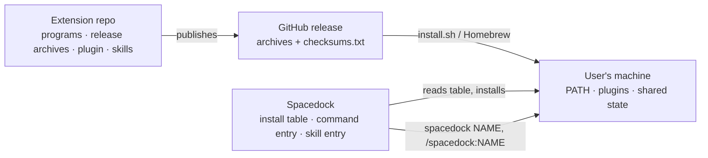

# Extension install contract

Status: v0 draft, awaiting agreement from each extension's maintainer
Date: 2026-10-12

## Outcome and ownership

A Spacedock extension is a separately developed and released product that one
Spacedock install brings along. Spacedock installs it from the extension's own
releases, finds it on PATH, and hands work to it. Nothing else about how an
extension is built or installed is Spacedock's concern. This file is the whole
seam: an extension that meets it installs and runs with `brew install spacedock`
or the `install.sh` line, and one that changes it breaks that path.



- **Spacedock owns** the install table, the two entry points, and the companion
  plugin list.
- **Each extension owns** its programs, its release archives and checksums,
  its plugin and skills, and everything they do once started.

## Entry points

**Command.** `spacedock NAME ARGS…` runs the first `spacedock-NAME` on PATH with
`ARGS…` passed verbatim, and returns its exit code. Built-in commands always win.
A `NAME` that starts with `-` or contains `/` is never looked up. A match found
through a relative PATH entry is ignored. With no match, Spacedock prints
`unknown command: NAME` and exits 2. An extension provides `spacedock-NAME` as a
second name for its own program.

**Skill.** `/spacedock:NAME` is a skill in the Spacedock plugin. It stays thin:
it checks the extension is present, decides anything Spacedock owns, and hands off
to the extension's own skill or to `spacedock NAME`. It never reimplements extension behaviour.

## Release archives

An extension that Spacedock installs publishes, on its GitHub repository:

1. Releases on the channel the user installs Spacedock from. The stable
   channel reads `releases/latest`, which skips prereleases. The edge channel
   (`SPACEDOCK_CHANNEL=edge`) reads the newest release, prereleases included, so
   an extension's beta reaches beta users through a GitHub prerelease.
2. One archive per target, named `PREFIX_VERSION_OS_ARCH.tar.gz`, where `OS` is
   `darwin` or `linux` and `ARCH` is `arm64` or `amd64`. All four must exist,
   even when the payload is the same.
3. `VERSION` equal to the release tag without its leading `v`, prerelease
   suffix included. Tag `v0.29.0` publishes `PREFIX_0.29.0_darwin_arm64.tar.gz`;
   tag `v0.16.0-beta.2` publishes `PREFIX_0.16.0-beta.2_darwin_arm64.tar.gz`.
4. `checksums.txt` in the same release, one line per archive in the form
   `SHA256  FILENAME` (the output of `shasum -a 256`).
5. Programs at the archive root for kind `bin`. For kind `tree`, one top-level
   directory with the programs at the paths the table row lists, beside any files they
   run with.

Spacedock verifies each archive against `checksums.txt` before installing it.

## Install table

`install.sh` holds one row per extension in `EXTRAS`:

```text
name|repo|archive prefix|programs|links|kind
```

- `programs`: space-separated programs to install. A program the archive does not
  carry is skipped.
- `links`: space-separated `program:extra-name` pairs. One of them must name
  `spacedock-NAME`.
- `kind`: `bin` copies each program into the install directory. `tree` unpacks
  the archive under `${XDG_DATA_HOME:-~/.local/share}/NAME/VERSION/` and links each
  program path from there, for extensions whose program is a directory of files.

For example, a `bin` extension `hello` that ships `hello-tui` and
`hello-client` has this row:

```text
hello|spacedock-dev/hello|hello|hello-tui hello-client|hello-tui:spacedock-hello|bin
```

The Go table `extensions` in `internal/cli` names the same extensions, so that
`spacedock doctor` and `spacedock update` can read them. The two tables must agree.
Both are empty until a product adds its row.

A failed extra (unresolvable release, failed download, checksum mismatch) is
reported and skipped; Spacedock's own install still succeeds.

The edge channel installs the extensions. The stable channel installs none, because
no stable marketplace pin matches a stable release yet. `SPACEDOCK_EXTRAS=1` makes
stable install their programs. Stable `spacedock install`, `doctor` and `update`
ignore the table, so on stable they install, expect and update no extension plugin.
`install.sh` runs the Claude Code plugin step only when it installs extensions:
a plain stable run neither adds a marketplace nor a plugin to Claude's settings.

On Homebrew, the edge cask `spacedock@next` depends on each extension's formula in
`spacedock-dev/tap`, and the stable cask depends on none. The formula provides the
same `spacedock-NAME` name. Formulas from other taps are refused, because Homebrew
does not load them as a transitive dependency on a fresh install.

## Plugins

When Spacedock installs its own plugin on the edge channel, it also installs
`NAME@spacedock` for each extension. Those plugins come from the `spacedock`
marketplace (`spacedock-dev/marketplace`, branch `main`) whatever Spacedock's
channel, and Spacedock adds that marketplace when it is missing and refreshes it
first. Spacedock's own plugin keeps its channel marketplace. Before each companion
install it removes `NAME@spacedock-edge`, the copy an earlier edge listing installed,
so a machine ends with one copy. Each companion step may fail without failing
Spacedock's. Claude Code does nothing when you install a
plugin that is already installed, so Spacedock runs `plugin update` after each
companion install. A companion that fails both steps is named in the output.

Each extension's own release keeps its listing on the `spacedock` marketplace
current. The edge marketplace lists Spacedock only. An extension without a listing on
the `spacedock` marketplace has no companion plugin: the companion install fails.
`SPACEDOCK_EXTENSION_MARKETPLACE_SOURCE` replaces the source of that marketplace, so a
test can stage a newer release.

## Compatibility

Spacedock does not pin extension versions. It asks the program that will do the work.
A program that offers a capability answers `--supports CAPABILITY` with exit 0.
Any other exit means no, and so does a program that is not on PATH.

Every extension program must answer `--version` with its version on the first line
of its output. A tree extension that does not yet do this has its version read from
its directory name, and Spacedock cannot ask it `--supports`.

Each hand-off names the program that does the work and the capability it needs.
Before a hand-off, the skill runs `--supports` for that program. When the answer is
no, the skill stops and tells the user to run `spacedock update`, then restart
Claude Code or run `/reload-plugins`.

`spacedock update` installs each extension's newest release on its channel. It
refreshes the plugins, and prints the version of every piece before and after.
`spacedock doctor` lists the same versions and names a program that differs from its
plugin, a second `spacedock` on PATH, and a missing program or plugin. An extension
may add rows and problems of its own to that list.

## Release asset names

The install table builds each archive name from the table row. An extension that
renames its release assets breaks the install for every user. Change the table first,
then publish the new names.

## Open in v0

- A Homebrew formula pattern for an extension that needs a runtime such as Python.
- Codex and Pi skill entries.
